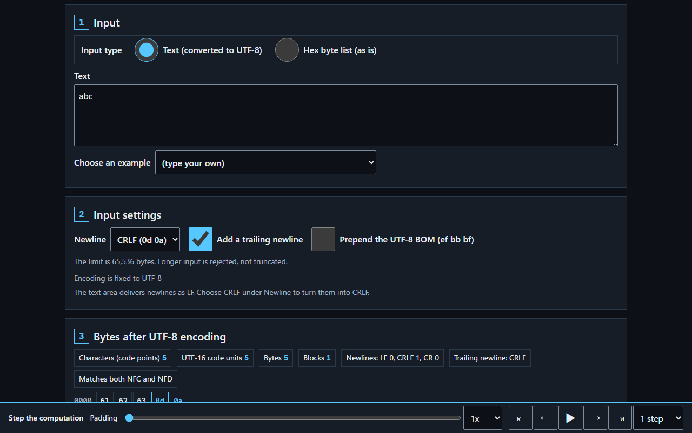
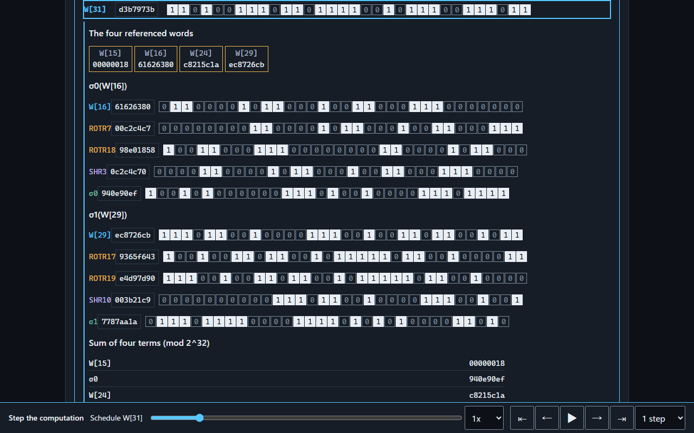
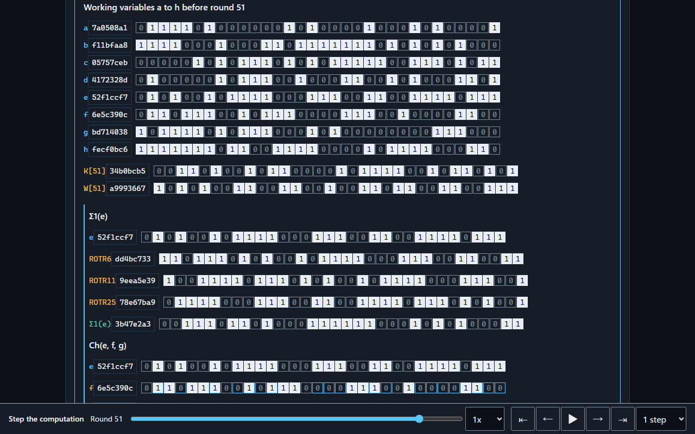
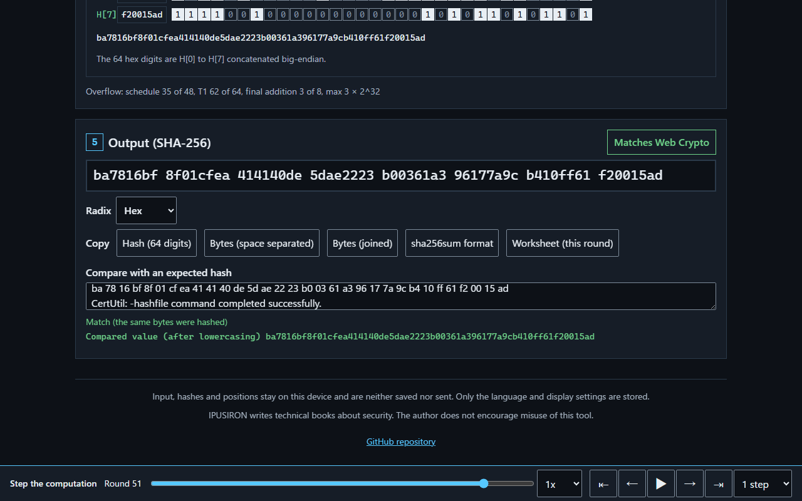

English · [日本語](README.md)

# SHA-256 Byte Inspector - See the bytes and every step of SHA-256


[](https://ipusiron.github.io/sha256-byte-inspector/)

**Day118 - 200 Security Tools with Generative AI**

SHA-256 Byte Inspector shows every byte that SHA-256 receives and lets you follow the computation one step at a time.
A hash (hash value) is the value a hash function outputs.

Two inputs that both look like "abc" can differ in their line endings, a trailing newline, a BOM or Unicode normalization, and then the bytes and the hash differ too. This tool shows all the bytes built from your input and draws, bit by bit, how padding, the message schedule, 64 rounds and the final addition lead to the 64-digit hash.


## 🌐 Demo

👉 **[Open SHA-256 Byte Inspector](https://ipusiron.github.io/sha256-byte-inspector/)**

You can also download `index.html` and open it from file://. Nothing to install or build.

## 📸 Screenshots



*"abc" with a trailing CRLF. Section 3 gains `0d 0a`, and the counts of characters, UTF-16 code units and bytes and the newline breakdown change.*



*Schedule word W[31]: the four words it reads (W[15], W[16], W[24], W[29]), the rotations and shifts of σ0 and σ1, and the four-term sum, in bits.*



*The working variables a to h before round 51, K[51] and W[51], and the three rotations of Σ1(e). Ch, Σ0, Maj, T1, T2 and the new a and e follow below.*



*The 64 digits with the Web Crypto check, the radix and the copy buttons. Pasting old-style certutil output (pairs of digits separated by spaces) into the comparison field extracts the 64 digits and compares them.*

## ✨ Features

The tool is a single page read from top to bottom in five sections.

| Section | Contents |
|---|---|
| 1. Input | Text (encoded as UTF-8) or hex bytes (as given), the input field, and examples (44 in five groups) |
| 2. Input settings | Line ending (LF or CRLF), add a trailing newline, add a UTF-8 BOM. Disabled for hex input |
| 3. Bytes after UTF-8 encoding | Counts of code points, UTF-16 code units, bytes and blocks, the newline breakdown, the trailing newline and the normalization status. A grid of all bytes with a legend for newlines, spaces, zero-width characters and more |
| 4. SHA-256 computation | The message block (512 bits), the schedule W[0] to W[63], the working variables a to h with a table of all 64 rounds, the final addition and the digest, all shown at once. The clock at the bottom of the screen highlights the current row and the rows it reads |
| 5. Output (SHA-256) | The 64 digits, the Web Crypto check, the radix (hex, binary, decimal), five copy buttons and a comparison with an expected hash |

Japanese and English, dark and light. The round buttons at the top right switch them; changing the language keeps the input and the position of the computation.

## 📖 Usage

1. Type text into the input field, or switch to hex bytes and type something like `61 62 63`. The examples include contrasting pairs: the text `7b` and the hex `7b`, LF and CRLF, NFC and NFD, with and without a BOM, and reproductions from Day117
2. Choose the line ending, a trailing newline or a BOM if you need them. Newlines in the input field arrive as LF, so choose CRLF in the line ending setting to hash CRLF
3. In section 3, check the bytes that are actually passed and their count. The legend shows how many bytes a character takes and which bytes the invisible characters are
4. Drive the computation with the clock at the bottom of the screen: one step at a time with the buttons, any position with the slider, eight steps, a phase or a block at a time with the granularity, and automatically with ▶. Pressing a row of the 64-round table moves to that round
5. Read the 64 digits in section 5, switch the radix, copy, or paste the output of another tool to compare

On the keyboard: ← and → move one step, Shift+← and Shift+→ eight steps, PageUp and PageDown one phase, Home and End to the first and last step, 1 to 6 to each phase, Space plays and pauses, and "?" opens the help. Keys go to the input field or the select that has the focus.

The URL fragment can pass an input and a position. For example `#text=abc%0A&at=b1.r51&r=bin&l=ja` opens the four bytes of "abc" plus LF at round 51, in binary, in Japanese. The fragment is removed from the URL after it is read.

## 🔬 SHA-256 computation and checks

The computation follows FIPS 180-4.

- Padding: `80` right after the message, then `00` until the length is 56 modulo 64, then the original length in bits as a 64-bit big-endian number. Up to 55 bytes give one block; from 56 bytes there are two
- Schedule: W[t] = σ1(W[t−2]) + W[t−7] + σ0(W[t−15]) + W[t−16] for t = 16 to 63, added modulo 2^32
- Rounds: T1 = h + Σ1(e) + Ch(e,f,g) + K[t] + W[t] and T2 = Σ0(a) + Maj(a,b,c). The new a is T1 + T2 and the new e is d + T1
- Final addition: the working variables are added to H[i]. With several blocks, the output of one block is the initial value of the next

One block takes 116 steps: padding 1, split 1, schedule 48, rounds 64, final addition 1 and digest 1 (230 steps for two blocks, 1,826 for sixteen). The carries dropped above 2^32 in every sum are counted and shown. For "abc", 35 of the 48 schedule sums, 62 of the 64 T1 sums and 3 of the 8 final additions overflow.

The hash on the screen comes from the tool's own JavaScript implementation and is compared with the browser's Web Crypto (`crypto.subtle.digest`) every time. The tests check it against these official values.

| Source | Cases | What is checked |
|---|---|---|
| NIST SHA-256 Examples ("abc" and the 56-byte example) | 2 | W[0] to W[15] of each block, the working variables of all 64 rounds, the digest |
| NIST SHA-2 Additional Test Data | 13 | Digest (the three huge cases only with `SHA256_SLOW=1`) |
| NIST CAVP (ShortMsg, LongMsg, Monte) | 65, 64, 100 | Digest |
| RFC 6234 section 8.5 | 7 | Digest |
| Day117 Hash Chain Tamper Trainer | 5 | Inputs and hashes of the reproductions |

No expected value is typed by hand: each is extracted by the scripts in `test/tools/` from the originals bundled in `test/vectors/`, or computed with `node:crypto` at test time. The sources and SHA-256 values of the originals are in `test/vectors/NOTICE.md`.

## 🎯 Use cases

Three uses that are particular to this tool:

- Switch between the text `7b` (two bytes, `37 62`) and the hex `7b` (one byte, the same as `{`) and see why inputs that look the same give different hashes
- Follow a Day117 hash byte by byte with the Day117 examples, and see that the previous hash is joined as a 64-character hex string
- In a class, set 55-byte and 56-byte inputs side by side to show the padding boundary, and explain Ch and Maj while the rounds play automatically

You can also paste the output of other tools (sha256sum, shasum, certutil, Get-FileHash) into the comparison field to see whether they hashed the same bytes.

## ⚠️ Limits and assumptions

- The tool does not detect tampering or find preimages. Matching hashes only show that the same bytes were hashed
- The JavaScript SHA-256 is written for teaching. Use an implementation such as `crypto.subtle` in production
- Input is limited to 65,536 bytes; longer input is rejected, not truncated. The byte grid colours only the first 4,096 bytes
- Browsers turn newlines in a text field into LF, so text with CRLF is made with the line ending setting. Reading files is not supported
- The standard states that K and H0 come from the fractional parts of the cube and square roots of the first primes, but gives only the values of the rotation and shift amounts, with no reason for the choice. Showing the derivation of the constants is not implemented
- When a long input changes the number of blocks, redrawing the computation section takes time. While you type, the section is redrawn once the keys are still

The author, IPUSIRON, writes books on information security. The author does not encourage misuse of this tool.

## 🔒 Privacy and security

The input, the hash and the position of the computation stay on your device and are neither saved nor sent. localStorage holds only the language in `sha256-byte-inspector.lang` and the theme in `sha256-byte-inspector.display`. sessionStorage, cookies and IndexedDB are not used.

An input in the URL fragment is not sent to the server but stays in the browser history. The page removes the fragment from the URL after reading it.

The CSP `connect-src 'none'` blocks network access, and the DOM is built with `textContent` and `createElement`. No CDN, external fonts or dependencies.

## 🔗 References and related tools

- [FIPS 180-4 — Secure Hash Standard (SHS)](https://doi.org/10.6028/NIST.FIPS.180-4)
- [NIST — Examples with Intermediate Values (SHA-256)](https://csrc.nist.gov/projects/cryptographic-standards-and-guidelines/example-values)
- [NIST CAVP — Secure Hashing](https://csrc.nist.gov/projects/cryptographic-algorithm-validation-program/secure-hashing)
- [RFC 6234 — US Secure Hash Algorithms (SHA and SHA-based HMAC and HKDF)](https://www.rfc-editor.org/rfc/rfc6234)
- [sha256algorithm.com](https://sha256algorithm.com/): an earlier step-by-step view of SHA-256 (dmarman). Its colours, layout, wording and code are not used here

- [Day117 Hash Chain Tamper Trainer](https://ipusiron.github.io/hash-chain-tamper-trainer/): tampering with a hash chain and rechaining it
- [Day056 HashViz](https://ipusiron.github.io/hashviz/): avalanche and collision statistics
- [Day114 Hex Dump Trainer](https://ipusiron.github.io/hex-dump-trainer/): reading hex dumps
- [Day052 BaseXX Visualizer](https://ipusiron.github.io/basexx-visualizer/): encoding byte strings
- [Day023 WeirdString Inspector](https://ipusiron.github.io/weirdstring-inspector/): finding invisible and look-alike characters
- [Day002 Hash Identifier](https://ipusiron.github.io/hash-detector/): formats of hash strings

## 🧪 Tests

Run with Node 22 or later, without installing any packages.

```sh
npm test
node --check sha256-core.js
node --check app.js
```

The tests cover the official test vectors, agreement between the JavaScript implementation and Web Crypto, invariants such as the round recurrence and the final addition, boundaries (55, 56 and 64 bytes, 65,536 bytes), UTF-8 encoding of text and the reading of hex. They also check the HTML, the CSP, the Japanese and English dictionaries, contrast, the CSS and the READMEs. GitHub Actions runs a syntax check of every JavaScript file and `npm test` on push and pull_request.

## 📁 Directory structure

```text
sha256-byte-inspector/                    # Root of the tool
├── .gitattributes                        # Keeps the line endings of the vector originals
├── .github/                              # GitHub settings
│   └── workflows/                        # Automated checks
│       └── test.yml                      # Syntax check and tests
├── .gitignore                            # Git exclusions
├── CLAUDE.md                             # Notes for developers
├── LICENSE                               # MIT License
├── README.en.md                          # English description
├── README.md                             # Japanese description
├── app.js                                # Screen and interaction
├── assets/                               # Screenshots and animation
│   ├── demo-rounds.gif                   # Stepping through rounds
│   ├── en/                               # English screenshots
│   │   ├── input.png                     # Input and bytes
│   │   ├── output.png                    # Output and comparison
│   │   ├── round.png                     # Round computation
│   │   └── schedule.png                  # Schedule computation
│   ├── help.png                          # Help dialog
│   ├── input.png                         # Input and bytes
│   ├── output.png                        # Output and comparison
│   ├── round.png                         # Round computation
│   └── schedule.png                      # Schedule computation
├── index.html                            # The single page
├── input-core.js                         # UTF-8 encoding and hex reading
├── messages.js                           # Japanese and English wording
├── package.json                          # Test command
├── presets.js                            # 44 example inputs
├── sha256-core.js                        # SHA-256 with a trace
├── style.css                             # Layout and themes
├── test/                                 # Automated tests
│   ├── app.test.js                       # Screen wiring
│   ├── boundary.test.js                  # Boundaries
│   ├── cavp.test.js                      # CAVP vectors
│   ├── contrast.test.js                  # Contrast
│   ├── core.test.js                      # Computation and NIST examples
│   ├── css.test.js                       # CSS
│   ├── day117.test.js                    # Day117 reproductions
│   ├── html.test.js                      # HTML and CSP
│   ├── i18n.test.js                      # Dictionaries and wording
│   ├── input.test.js                     # Input rules
│   ├── readme.test.js                    # Documentation matches the code
│   ├── rfc6234.test.js                   # RFC 6234 vectors
│   ├── tools/                            # Extraction of expected values
│   │   ├── extract-day117-inputs.js      # Day117 reproductions
│   │   ├── extract-nist-examples.js      # NIST examples
│   │   ├── extract-rfc6234.js            # RFC 6234
│   │   ├── extract-sha2-additional.js    # SHA-2 Additional
│   │   ├── rsp.js                        # Reading CAVP files
│   │   └── support.js                    # Shared helpers
│   ├── vectors/                          # Vector originals and extracted values
│   │   ├── NOTICE.md                     # Sources and notices
│   │   ├── day117-chain-vectors.json     # Day117 expected values
│   │   ├── day117-inputs.json            # Day117 reproductions
│   │   ├── nist-cavp/                    # CAVP originals
│   │   │   ├── Readme.txt                # CAVP description
│   │   │   ├── SHA256LongMsg.rsp         # Long messages
│   │   │   ├── SHA256Monte.rsp           # Monte Carlo
│   │   │   └── SHA256ShortMsg.rsp        # Short messages
│   │   ├── nist-sha256-examples.txt      # Original of the NIST examples
│   │   ├── nist-sha256-rounds.json       # Rounds of the examples
│   │   ├── rfc6234-sha256.json           # Extracted from RFC 6234
│   │   ├── rfc6234.txt                   # Original of RFC 6234
│   │   ├── sha2-additional-sha256.json   # Extracted from SHA-2 Additional
│   │   └── sha2-additional.txt           # Original of SHA-2 Additional
│   └── view.test.js                      # Rendering models
└── trace-view.js                         # Rendering models
```

## 💻 Requirements

Any browser with JavaScript and SHA-256 in Web Crypto. Works over HTTPS, local HTTP and file://.

| Engine | Checked |
|---|---|
| Chromium 145 | file:// and HTTPS, widths 320, 390, 768, 1280 and 1527 px, dark and light, Japanese and English |

Firefox, Safari, real phones and screen readers are not verified. Where Web Crypto is unavailable, only the JavaScript value is shown, marked as unchecked.

## 📄 License

The source code is under the [MIT License](LICENSE). Rights and notices for the originals in `test/vectors/` are as stated in `test/vectors/NOTICE.md` (NIST works are not subject to copyright in the United States; the RFC is an IETF Trust document).

## 🛠️ About this tool

This tool is part of the "200 Security Tools with Generative AI" project.
The project builds and publishes security-related tools over 200 days with the help of AI.

See the [project page](https://akademeia.info/?page_id=44607) for details and other tools.
