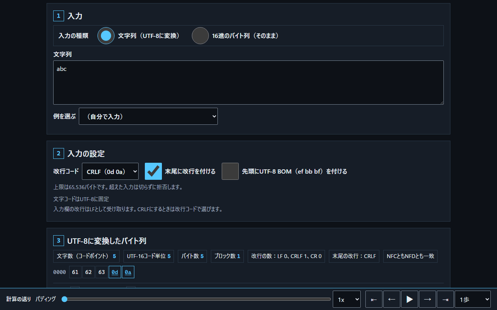
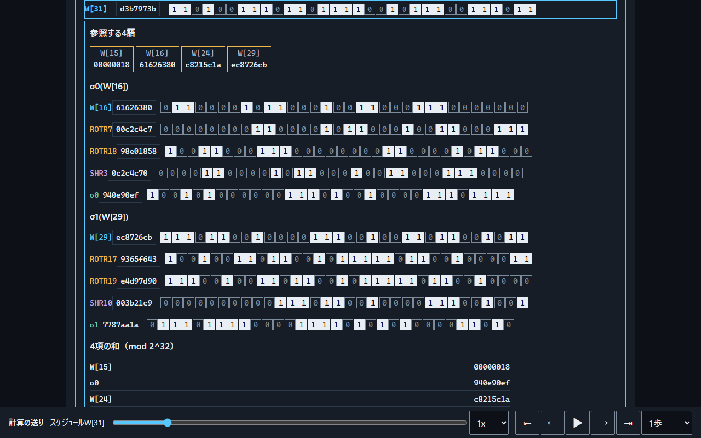
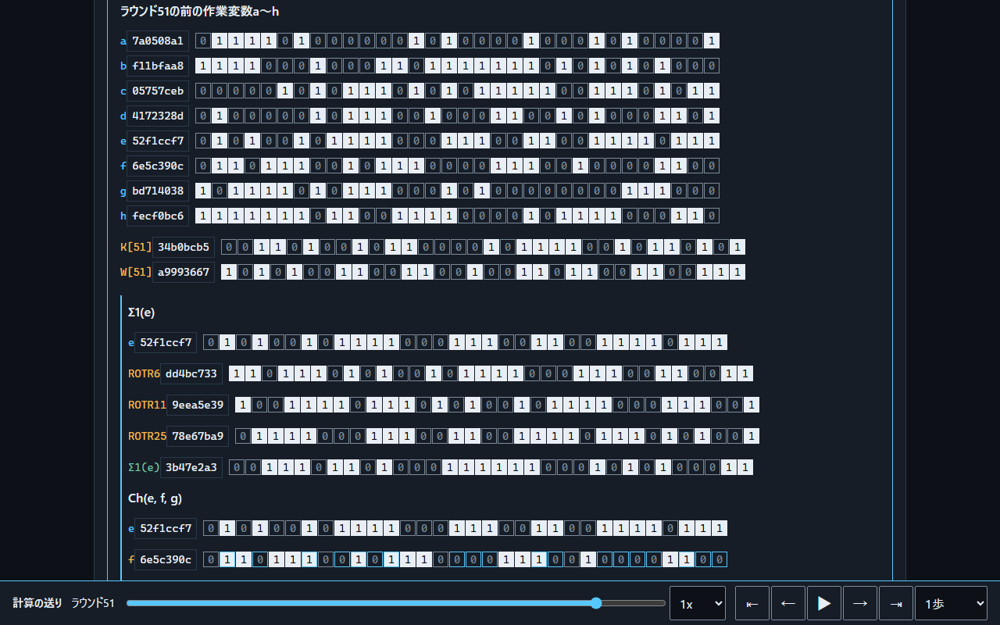
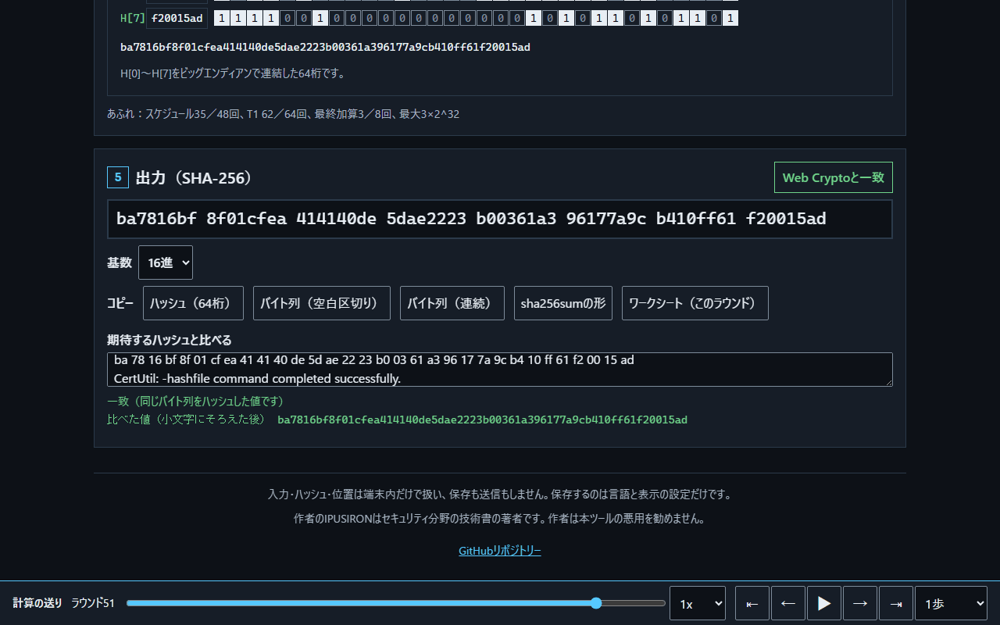
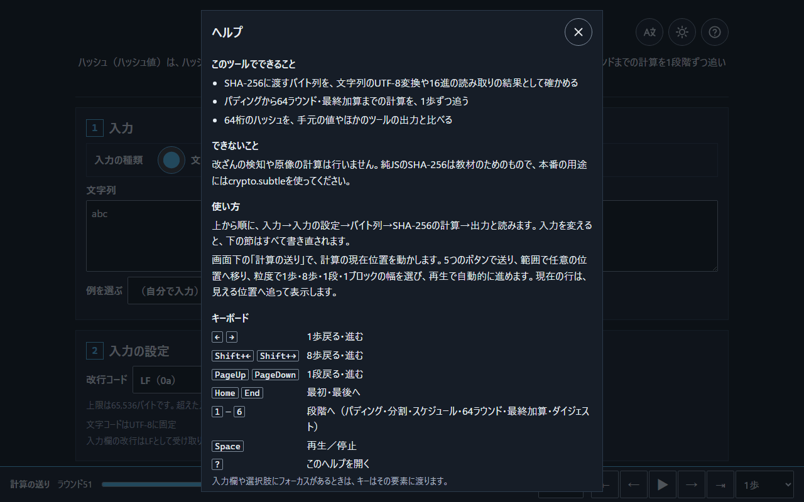

<!--
---
id: day118
slug: sha256-byte-inspector
title: "SHA-256 Byte Inspector"
subtitle_ja: "SHA-256に渡すバイト列と計算の中身を見る"
subtitle_en: "See the bytes and every step of SHA-256"
description_ja: "文字列や16進のバイト列がSHA-256に渡る形を全バイトで示し、パディングから64ラウンド・最終加算までの計算を1歩ずつ追う教材"
description_en: "Shows every byte that SHA-256 receives from text or hex input and steps through padding, the message schedule, 64 rounds and the final addition"
category_ja: [ハッシュ関数, 現代暗号]
category_en: [Hash Function, Modern Cryptography]
difficulty: 3
tags: [sha256, hash, utf-8, padding, fips-180-4, visualization, offline]
repo_url: "https://github.com/ipusiron/sha256-byte-inspector"
demo_url: "https://ipusiron.github.io/sha256-byte-inspector/"
hub: true
---
-->

# SHA-256 Byte Inspector - SHA-256に渡すバイト列と計算の中身を見る


[](https://ipusiron.github.io/sha256-byte-inspector/)

**Day118 - 生成AIで作るセキュリティツール200**

[English](README.en.md) · 日本語

SHA-256 Byte Inspectorは、SHA-256に渡すバイト列を隠さずに示し、計算の中身を1歩ずつ追える教材です。
ハッシュ（ハッシュ値）は、ハッシュ関数が出力する値です。

同じ「abc」に見えても、改行コード・末尾の改行・BOM・Unicodeの正規化が違えば、渡すバイト列もハッシュも変わります。本ツールは入力から作ったバイト列を全バイトで表示し、パディング、メッセージスケジュール、64ラウンド、最終加算を経て64桁のハッシュになるまでを、ビットの並びで見せます。


## 🌐 デモページ

👉 **[SHA-256 Byte Inspectorを開く](https://ipusiron.github.io/sha256-byte-inspector/)**

ダウンロードした`index.html`をブラウザーで開くと、file://でも使えます。インストールとビルドは不要です。

## 📸 スクリーンショット



*「abc」に末尾のCRLFを付けたところです。3節のバイト列に`0d 0a`が加わり、文字数・UTF-16コード単位・バイト数・改行の内訳が変わります。*



*スケジュールのW[31]です。参照する4語（W[15]・W[16]・W[24]・W[29]）と、σ0・σ1の回転とシフト、4項の和をビットで示します。*



*ラウンド51の前の作業変数a〜h、K[51]・W[51]、Σ1(e)の3つの回転です。この下にCh・Σ0・Maj・T1・T2と新しいa・eが続きます。*



*出力の64桁とWeb Cryptoとの一致、基数とコピーのボタンです。比較欄に旧形式のcertutilの出力（2桁ずつ空白区切り）を貼ると、64桁を抜き出して比べます。*



*見出し右の「?」で開くヘルプです。できること・できないこと、使い方、キーボード、入力のコツをまとめています。*

## ✨ 機能

ページは1枚で、上から次の5節を順に読みます。

| 節 | 内容 |
|---|---|
| 1. 入力 | 文字列（UTF-8に変換）と16進のバイト列（そのまま）の切り替え、入力欄、例を選ぶ（5グループ44件） |
| 2. 入力の設定 | 改行コード（LF・CRLF）、末尾に改行を付ける、先頭にUTF-8 BOMを付ける。16進のときは無効 |
| 3. UTF-8に変換したバイト列 | 文字数・UTF-16コード単位・バイト数・ブロック数、改行の内訳、末尾の改行、正規化の状態。全バイトの格子と、改行・空白・ゼロ幅文字などの凡例 |
| 4. SHA-256の計算 | メッセージブロック（512ビット）、スケジュールW[0]〜W[63]、作業変数a〜hと64ラウンドの表、最終加算、ダイジェストを常に表示。画面下の「計算の送り」で現在の行と参照元が光る |
| 5. 出力（SHA-256） | 64桁、Web Cryptoとの一致、基数（16進・2進・10進）、コピー5種、期待するハッシュとの比較 |

日本語・英語と明暗の表示に対応しています。初めて開いたときは青焼き（ダーク）の表示です。見出し右の丸ボタンで切り替え、言語を変えても入力と計算の位置は保ちます。

## 📖 使い方

1. 入力欄に文字列を入れるか、16進のバイト列に切り替えて`61 62 63`のように入れる。「例を選ぶ」には、`7b`という文字列と16進の`7b`、LFとCRLF、NFCとNFD、BOMの有無、Day117の再現例などの対照の組がある
2. 必要なら改行コード・末尾の改行・BOMを選ぶ。入力欄の改行はLFとして受け取るので、CRLFで計算したいときは改行コードで選ぶ
3. 3節で、実際に渡すバイト列とバイト数を確かめる。1文字が何バイトになるか、見えない文字がどのバイトかを凡例で読める
4. 画面下の「計算の送り」で計算を進める。ボタンで1歩ずつ、範囲で任意の位置へ、粒度で8歩・1段・1ブロック単位に送り、▶で自動的に進める。64ラウンドの表の行を押すと、そのラウンドへ移る
5. 5節で64桁を読み、基数を切り替えたり、コピーしたり、手元のツールの出力を貼って比べたりする

キーボードでは、←→で1歩、Shift＋←→で8歩、PageUp・PageDownで1段、Home・Endで最初と最後、1〜6で各段階、空白で再生と停止、「?」でヘルプを開きます。入力欄や選択肢にフォーカスがあるときは、キーはその要素に渡ります。

URLの`#`で入力と位置を渡すこともできます。たとえば`#text=abc%0A&at=b1.r51&r=bin&l=ja`は、「abc」とLFの4バイトをラウンド51の位置・2進・日本語で開きます。読み込んだあとはURLの`#`を消します。

## 🔬 SHA-256の計算と検算

計算はFIPS 180-4のとおりです。

- パディング：メッセージの直後に`80`、全長が64で割って56余るまで`00`、最後に元の長さ（ビット）を64ビットのビッグエンディアンで置く。55バイトまでは1ブロック、56バイトからは2ブロック
- スケジュール：W[t]＝σ1(W[t−2])＋W[t−7]＋σ0(W[t−15])＋W[t−16]（t＝16〜63、2^32を法とする和）
- ラウンド：T1＝h＋Σ1(e)＋Ch(e,f,g)＋K[t]＋W[t]、T2＝Σ0(a)＋Maj(a,b,c)。新しいaはT1＋T2、新しいeはd＋T1
- 最終加算：H[i]に作業変数を足す。複数ブロックでは、前のブロックの出力が次の初期値になる

1ブロックの計算は、パディング1歩、分割1歩、スケジュール48歩、ラウンド64歩、最終加算1歩、ダイジェスト1歩の116歩です（2ブロックで230歩、16ブロックで1,826歩）。各和で2^32を超えて捨てた桁も数えて表示します。「abc」では、スケジュールの48回の和のうち35回、T1の64回のうち62回、最終加算の8回のうち3回で桁があふれます。

画面のハッシュは、本ツールの純JavaScriptの実装で計算し、ブラウザーのWeb Crypto（`crypto.subtle.digest`）の値と毎回比べます。テストでは、次の公式の値と一致することを確かめます。

| 出典 | 件数 | 確かめる内容 |
|---|---|---|
| NIST SHA-256 Examples（abcと56バイトの例） | 2 | 各ブロックのW[0]〜W[15]、64ラウンドの作業変数、ダイジェスト |
| NIST SHA-2 Additional Test Data | 13 | ダイジェスト（巨大な3件は`SHA256_SLOW=1`のときだけ） |
| NIST CAVP（ShortMsg・LongMsg・Monte） | 65・64・100 | ダイジェスト |
| RFC 6234 8.5 | 7 | ダイジェスト |
| Day117 Hash Chain Tamper Trainer | 5 | 再現例の入力とハッシュ |

期待値は手で書かず、`test/vectors/`に同梱した原本から`test/tools/`のスクリプトで抽出するか、テスト時に`node:crypto`で計算します。原本の出所とSHA-256は`test/vectors/NOTICE.md`にあります。

## 🎯 ユースケース

このツールならではの使い方として、次の3例を試せます。

- 文字列の`7b`（`37 62`の2バイト）と16進の`7b`（1バイト。`{`と同じ）を切り替え、同じ見た目の入力からハッシュが変わる理由を確かめる
- Day117で計算したハッシュを、「例を選ぶ」のDay117の再現例で1バイトずつ追う。前のハッシュは16進の文字列64文字として連結されることを確かめる
- 授業で、55バイトと56バイトの入力を並べてパディングの境目を示し、ラウンドを自動再生しながらCh・Majの働きを説明する

ほかのツールの出力（sha256sum・shasum・certutil・Get-FileHash）を比較欄に貼り、手元の計算と同じバイト列かどうかを確かめる使い方もできます。

## ⚠️ 制約と前提

- 改ざんの検知や原像の計算は行わない。ハッシュの一致は、同じバイト列を計算したことを示すだけ
- 純JavaScriptのSHA-256は教材のための実装。本番の用途には`crypto.subtle`などの実装を使う
- 入力の上限は65,536バイト。超えた入力は切らずに拒否する。バイトの格子に色を付けるのは先頭の4,096バイトまで
- 入力欄の改行はブラウザーがLFにそろえるため、CRLFを含む文字列は改行コードの選択で作る。ファイルの読み込みには対応していない
- K・H0は最初の素数の立方根・平方根の小数部から取ると標準に書かれているが、回転量とシフト量は値だけが定められ、選んだ理由の記述はない。定数の導出を画面で見せる機能は未実装
- 長い入力でブロック数が変わると、計算の節の書き直しに時間がかかる。入力中は打鍵が止まってから計算の節を書き直す

作者のIPUSIRONはセキュリティ分野の技術書の著者です。作者は本ツールの悪用を勧めません。

## 🔒 プライバシーと安全対策

入力・ハッシュ・計算の位置は端末内だけで扱い、保存も送信もしません。localStorageには、言語の選択を`sha256-byte-inspector.lang`、明暗の選択を`sha256-byte-inspector.display`に保存します。sessionStorage・Cookie・IndexedDBは使いません。

URLの`#`に入れた入力はサーバーへ送られませんが、ブラウザーの履歴には残ります。読み込んだあとはページ内でURLの`#`を消します。

CSPの`connect-src 'none'`で通信を制限し、DOMは`textContent`と`createElement`で構築します。CDN・外部フォント・依存パッケージはありません。

## 🔗 参考文献と関連ツール

- [FIPS 180-4 — Secure Hash Standard (SHS)](https://doi.org/10.6028/NIST.FIPS.180-4)
- [NIST — Examples with Intermediate Values (SHA-256)](https://csrc.nist.gov/projects/cryptographic-standards-and-guidelines/example-values)
- [NIST CAVP — Secure Hashing](https://csrc.nist.gov/projects/cryptographic-algorithm-validation-program/secure-hashing)
- [RFC 6234 — US Secure Hash Algorithms (SHA and SHA-based HMAC and HKDF)](https://www.rfc-editor.org/rfc/rfc6234)
- [sha256algorithm.com](https://sha256algorithm.com/)：SHA-256の計算を段階ごとに見せる先行例（dmarman）。配色・配置・文言・コードは使っていない

- [Day117 Hash Chain Tamper Trainer](https://ipusiron.github.io/hash-chain-tamper-trainer/)：ハッシュチェーンの改変と作り直し
- [Day056 HashViz](https://ipusiron.github.io/hashviz/)：雪崩効果と衝突の統計
- [Day114 Hex Dump Trainer](https://ipusiron.github.io/hex-dump-trainer/)：16進ダンプの読み方
- [Day052 BaseXX Visualizer](https://ipusiron.github.io/basexx-visualizer/)：バイト列のエンコード
- [Day023 WeirdString Inspector](https://ipusiron.github.io/weirdstring-inspector/)：見えない文字やそっくり文字の検出
- [Day002 Hash Identifier](https://ipusiron.github.io/hash-detector/)：ハッシュ文字列の形式

## 🧪 テスト

Node 22以上で、依存パッケージを入れずに実行できます。

```sh
npm test
node --check sha256-core.js
node --check app.js
```

公式のテストベクトル、純JavaScriptとWeb Cryptoの一致、ラウンドの漸化・最終加算などの不変条件、境界値（55・56・64バイト、65,536バイト）、文字列のUTF-8化と16進の読み取りを検査します。HTML・CSP・日英の辞書・コントラスト・CSS・READMEも検査します。GitHub Actionsはpushとpull_requestで、すべてのJavaScriptの構文検査と`npm test`を実行します。

## 📁 ディレクトリー構造

```text
sha256-byte-inspector/                    # 教材のルート
├── .gitattributes                        # ベクトル原本の改行を保つ設定
├── .github/                              # GitHubの設定
│   └── workflows/                        # 自動検査
│       └── test.yml                      # 構文検査とテスト
├── .gitignore                            # Gitの除外設定
├── CLAUDE.md                             # 開発者向け説明
├── LICENSE                               # MITライセンス
├── README.en.md                          # 英語の説明
├── README.md                             # 日本語の説明
├── app.js                                # 画面と操作
├── assets/                               # 画面例とアニメーション
│   ├── demo-rounds.gif                   # ラウンドを送る様子
│   ├── en/                               # 英語の画面例
│   │   ├── input.png                     # 入力とバイト列
│   │   ├── output.png                    # 出力と比較欄
│   │   ├── round.png                     # ラウンドの計算
│   │   └── schedule.png                  # スケジュールの計算
│   ├── help.png                          # ヘルプのダイアログ
│   ├── input.png                         # 入力とバイト列
│   ├── output.png                        # 出力と比較欄
│   ├── round.png                         # ラウンドの計算
│   └── schedule.png                      # スケジュールの計算
├── index.html                            # 1枚のページ
├── input-core.js                         # UTF-8化と16進の読み取り
├── messages.js                           # 日英の文言
├── package.json                          # テストのコマンド
├── presets.js                            # 例の入力44件
├── sha256-core.js                        # トレース付きのSHA-256
├── style.css                             # 配置と明暗の配色
├── test/                                 # 自動テスト
│   ├── app.test.js                       # 画面の結線の検査
│   ├── boundary.test.js                  # 境界値の検査
│   ├── cavp.test.js                      # CAVPのベクトル
│   ├── contrast.test.js                  # コントラストの検査
│   ├── core.test.js                      # 計算とNISTの例題
│   ├── css.test.js                       # CSSの検査
│   ├── day117.test.js                    # Day117の再現
│   ├── html.test.js                      # HTMLとCSPの検査
│   ├── i18n.test.js                      # 辞書と文体の検査
│   ├── input.test.js                     # 入力の規則の検査
│   ├── readme.test.js                    # 説明と実装の一致
│   ├── rfc6234.test.js                   # RFC 6234のベクトル
│   ├── tools/                            # 期待値の抽出
│   │   ├── extract-day117-inputs.js      # Day117の再現例
│   │   ├── extract-nist-examples.js      # NISTの例題
│   │   ├── extract-rfc6234.js            # RFC 6234
│   │   ├── extract-sha2-additional.js    # SHA-2 Additional
│   │   ├── rsp.js                        # CAVPの読み取り
│   │   └── support.js                    # 共通の処理
│   ├── vectors/                          # ベクトルの原本と抽出結果
│   │   ├── NOTICE.md                     # 出所と著作権の表示
│   │   ├── day117-chain-vectors.json     # Day117の期待値
│   │   ├── day117-inputs.json            # Day117の再現例
│   │   ├── nist-cavp/                    # CAVPの原本
│   │   │   ├── Readme.txt                # CAVPの説明
│   │   │   ├── SHA256LongMsg.rsp         # 長いメッセージ
│   │   │   ├── SHA256Monte.rsp           # モンテカルロ
│   │   │   └── SHA256ShortMsg.rsp        # 短いメッセージ
│   │   ├── nist-sha256-examples.txt      # NISTの例題の原本
│   │   ├── nist-sha256-rounds.json       # 例題のラウンド
│   │   ├── rfc6234-sha256.json           # RFC 6234の抽出結果
│   │   ├── rfc6234.txt                   # RFC 6234の原本
│   │   ├── sha2-additional-sha256.json   # SHA-2 Additionalの抽出結果
│   │   └── sha2-additional.txt           # SHA-2 Additionalの原本
│   └── view.test.js                      # 描画モデルの検査
└── trace-view.js                         # 描画モデル
```

## 💻 動作環境

JavaScriptとWeb CryptoのSHA-256に対応するブラウザーで動きます。HTTPS、ローカルHTTP、file://で使えます。

| エンジン | 確認した範囲 |
|---|---|
| Chromium 145 | file://とHTTPS、幅320・390・768・1280・1527px、明暗、日本語と英語 |

Firefox・Safari・スマートフォンの実機、スクリーンリーダーの読み上げは未検証です。Web Cryptoが使えない環境では、純JavaScriptの値だけを「未確認」として表示します。

## 📄 ライセンス

ソースコードは[MIT License](LICENSE)です。`test/vectors/`の原本の権利と表示は`test/vectors/NOTICE.md`のとおりです（NISTの成果物は米国内では著作権の対象外、RFCはIETF Trustの文書）。

## 🛠️ このツールについて

本ツールは、「生成AIで作るセキュリティツール200」プロジェクトの一環として開発されました。
このプロジェクトでは、AIの支援を活用しながら、セキュリティに関連するさまざまなツールを200日間にわたり制作・公開していく取り組みを行っています。

プロジェクトの詳細や他のツールについては、[プロジェクトページ](https://akademeia.info/?page_id=44607)をご覧ください。
