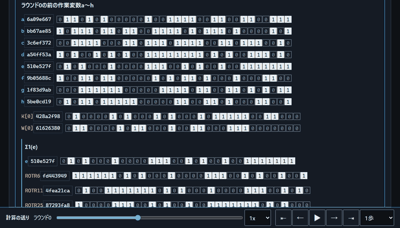

# SHA-256 Byte Inspector - SHA-256に渡すバイト列を隠さず確かめる

**Day118 - 生成AIで作るセキュリティツール200**

準備中です。文字列や16進のバイト列をSHA-256に渡す前に実際に渡す全バイトを見せ、パディングから64ラウンドまでの計算を1段階ずつ追える学習ツールとして開発しています。

## 📄 ライセンス

MIT License

## 🛠️ このツールについて

本ツールは「生成AIで作るセキュリティツール200」の一環として開発しています。作者は本ツールの悪用を勧めません。
